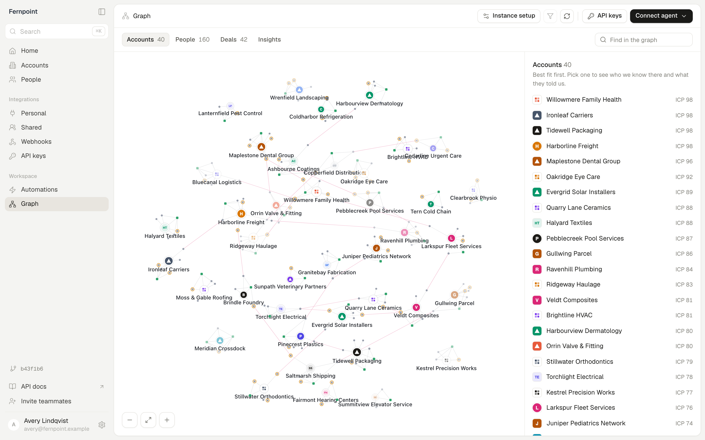
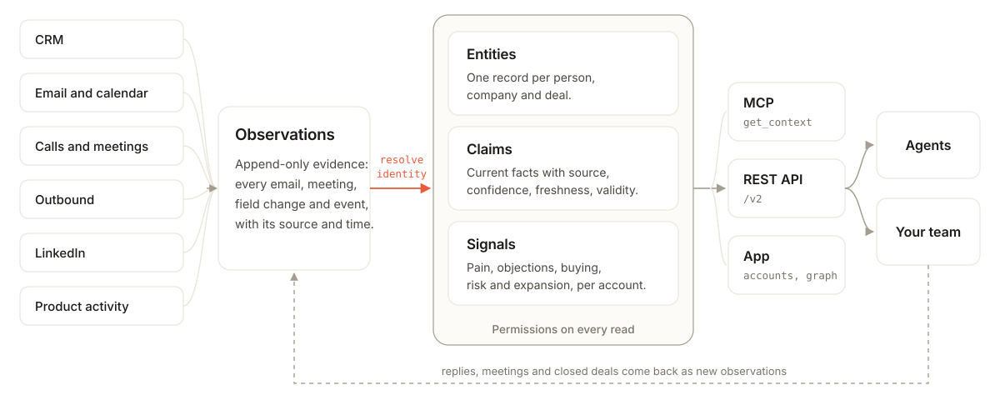

<p align="center">
  <picture>
    <source media="(prefers-color-scheme: dark)" srcset=".github/assets/logo-dark.svg" />
    <source media="(prefers-color-scheme: light)" srcset=".github/assets/logo-light.svg" />
    
  </picture>
</p>

<h3 align="center">The open-source revenue context graph</h3>

<p align="center">OpenNous unifies your team's conversations, meetings, CRM and signals into one context graph: one source of truth for your pipeline and customers.</p>

<div align="center">

[](LICENSING.md)
[](https://www.npmjs.com/package/@opennous/mcp)
[](https://discord.gg/wmbsDeAVm)

</div>

<p align="center">
  <a href="https://opennous.cloud">Website</a> ·
  <a href="https://docs.opennous.cloud">Docs</a> ·
  <a href="https://app.opennous.cloud">Cloud</a> ·
  <a href="https://discord.gg/wmbsDeAVm">Discord</a>
</p>

<p align="center">
  <picture>
    <source media="(prefers-color-scheme: dark)" srcset=".github/assets/hero-graph-dark.png" />
    <source media="(prefers-color-scheme: light)" srcset=".github/assets/hero-graph.png" />
    
  </picture>
</p>

<p align="center"><sub>From a fictional demo workspace. Every company, person and domain in it is invented.</sub></p>

## Key capabilities

- **Unified account records:** Resolve emails, meetings, transcripts, product activity and CRM fields to the right person, company and deal. Uncertain matches go to review, never to a guess.
- **Buying signals from every activity:** Extract pain, goals, objections, competitors, buying intent, risk, expansion and staff changes, each linked to its account.
- **Source citations:** Each claim carries its source, confidence and validity. New evidence updates it, conflicts stay reviewable, manual entries stay protected, and the whole graph can be rebuilt from its raw history.
- **Built for agents:** 35 REST endpoints and 13 MCP tools. One `get_context` call returns the account, shaped for meeting prep, follow-ups or account reviews.
- **Self-hosted and secure by default:** Run on your own database and model keys. Raw emails and transcripts stay with their participants, API keys can be read-only, and webhooks are signed.
- **Works with your stack:** 16 integrations across CRM, email, calendar, calls and outbound, plus LinkedIn.

## Quickstart

Self-host the full stack with Docker. The database and sign-in (Supabase's open-source Postgres, auth and API) run inside it, so there is no Supabase account to create.

You need Docker (Compose v2.24+), Node 18+, git, three DNS records (`app`, `api`, `mcp`) pointing at the machine, and an Anthropic API key. Linux servers use Docker Engine; macOS and Windows use Docker Desktop (or Colima / OrbStack on a Mac). Intel and ARM both work. On Windows, run the commands in WSL2 (recommended) or PowerShell; `./update.sh` needs WSL2 or Git Bash.

```bash
git clone https://github.com/NousC/opennous.git && cd opennous
cp nous.env.example nous.env
# in nous.env, set APP_DOMAIN, API_DOMAIN, MCP_DOMAIN and ANTHROPIC_API_KEY
node scripts/selfhost-keys.mjs nous.env
docker compose --env-file nous.env up -d --build
```

The key script generates the database password, JWT secret, Supabase keys, `ENCRYPTION_KEY` and `WORKER_SECRET`, and ends by printing the owner's setup link:

```
then create the owner account at https://app.yourdomain.com/signup?setup=<token>
```

Open it and create the first account; it becomes the owner. Sign-ups without the token are refused, so the instance is closed from the start. Add teammates with a join link from **Settings → Members → Create invite**. Lost the link? `docker compose --env-file nous.env logs db-schema` prints it until an owner exists.

The stack runs Postgres with pgvector, Supabase Auth (GoTrue), PostgREST, the app containers and Caddy for TLS. To try it on a laptop, set the domains to `localhost`, `api.localhost` and `mcp.localhost`; Caddy then signs with its own local certificate, so your browser warns once and the CLI needs that certificate ([Trying it on a laptop](docs/self-host-bundled.md#trying-it-on-a-laptop)). `./update.sh` pulls, rebuilds and applies new database migrations. The [self-host guide](https://docs.opennous.cloud/installation/docker-compose) covers email, backups and running against your own Supabase project instead.

To look around with fictional data first, load the demo workspace ("Fernpoint", 40 invented companies on `.example` domains):

```bash
docker compose --env-file nous.env cp supabase/seed/demo.sql db:/tmp/demo.sql
docker compose --env-file nous.env exec db psql -U postgres -v ON_ERROR_STOP=1 -1 -f /tmp/demo.sql
```

Then point your agent at your instance:

```bash
npx @opennous/cli@latest init --url https://api.yourdomain.com
```

## How it works

<p align="center">
  <picture>
    <source media="(prefers-color-scheme: dark)" srcset=".github/assets/how-it-works-dark.svg" />
    <source media="(prefers-color-scheme: light)" srcset=".github/assets/how-it-works-light.svg" />
    
  </picture>
</p>

1. **Observations.** Every email, meeting, CRM change and event from your tools lands as immutable evidence, with its source and time.
2. **Identity resolution.** Observations resolve to entities: one record per person, company and deal.
3. **Claims and signals.** From the evidence on each entity, OpenNous derives claims (the current value of a fact, with confidence and freshness) and extracts signals.
4. **Permission-aware answers.** Agents and your team read the result over MCP, the REST API and the app. Replies, meetings and closed deals come back as new observations, so the graph gets more accurate as you use it.

The repository is a pnpm workspace:

| Path | What it is |
|---|---|
| `packages/core` | Identity resolution, observations, entities, claims, reconcile, governance |
| `apps/api` | REST API, integrations, webhooks, automations |
| `apps/worker` | Ingestion, extraction, scoring and scheduled jobs |
| `apps/frontend` | Accounts, Graph, Activity, API keys, Integrations, Webhooks, Usage, Settings, automations |
| `apps/mcp` | `@opennous/mcp`, the MCP server |
| `apps/cli` | `@opennous/cli`, sign-in and agent setup |

More detail: [The context graph](docs/context-graph.md).

## Integrations

| Category | Tools |
|---|---|
| CRM | HubSpot, Salesforce, Attio |
| Email and calendar | Gmail, Google Calendar, any SMTP/IMAP mailbox |
| Calls and meetings | Fathom, Fireflies, Granola, Calendly, Cal.com |
| Outbound | Instantly, Smartlead, lemlist, HeyReach, EmailBison |
| LinkedIn | Through [Unipile](https://www.unipile.com) |

On self-host, Gmail and Google Calendar connect through your own Google OAuth app: set `GOOGLE_CLIENT_ID` and `GOOGLE_CLIENT_SECRET` in `nous.env` and register `https://<API_DOMAIN>/api/oauth/google/callback` on the client (the redirect is derived from `API_DOMAIN`). Access is read-only (`gmail.readonly`, `calendar.readonly`). Composio is optional: set `COMPOSIO_API_KEY` to connect through it instead.

Setup for each one is in the [provider docs](https://docs.opennous.cloud/providers/overview).

## Use it from your agent

`npx @opennous/cli@latest init` signs you in, saves a key to `~/.nous/config.json` and registers the MCP server with your agent. To wire it up by hand, add this to your MCP host config:

```json
{
  "mcpServers": {
    "opennous": {
      "command": "npx",
      "args": ["-y", "@opennous/mcp"],
      "env": {
        "NOUS_API_KEY": "your-workspace-key",
        "NOUS_API_URL": "https://api.yourdomain.com"
      }
    }
  }
}
```

Leave out `NOUS_API_URL` to use Cloud. Create keys under **Settings → API keys**.

The same data is on the REST API:

```bash
curl -X POST https://api.yourdomain.com/v2/context \
  -H "Authorization: Bearer $NOUS_API_KEY" \
  -H "Content-Type: application/json" \
  -d '{"focus": "acme.com", "intent": "meeting_prep"}'
```

Insights are read and written over MCP (`get_insights`, `record_insight`) and REST (`GET` and `POST /v2/insights`). See the [MCP docs](https://docs.opennous.cloud/mcp/introduction) and the [REST API reference](https://docs.opennous.cloud/public-api/introduction).

## Contributing

Read the [contributing guide](CONTRIBUTING.md) before you open a pull request. Questions go to [Discord](https://discord.gg/wmbsDeAVm). Security issues go through [SECURITY.md](SECURITY.md).

## License

The server is [AGPL-3.0](LICENSE). The MCP server and CLI (`apps/mcp`, `apps/cli`) are Apache-2.0, so installing them puts no obligations on your code. Details in [LICENSING.md](LICENSING.md).

## Star history

[](https://star-history.com/#NousC/opennous&Date)
