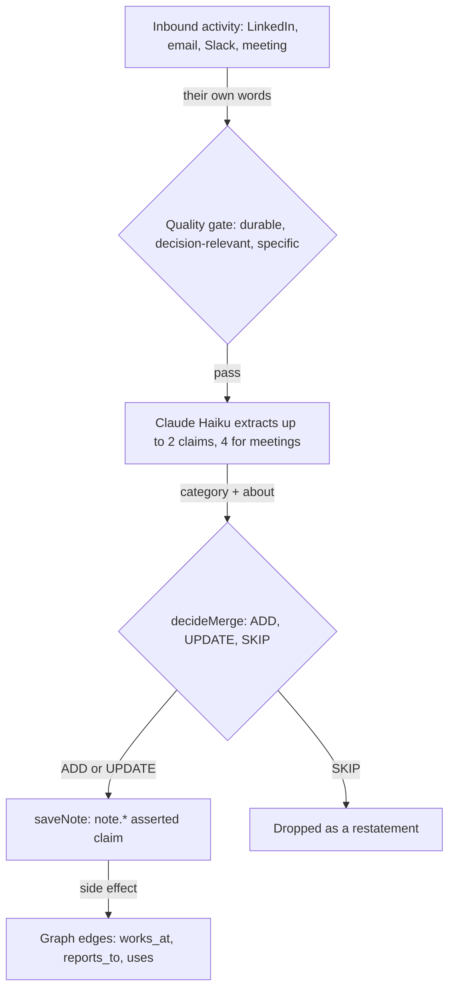

# Claims (Intel)

Most CRMs only hold the fields a human types into them. Nous also extracts durable **claims** from the actual conversation: what a person reveals about their goals, their stack, their pain, their budget, in their own words, across email, LinkedIn, Slack, and meetings. These extracted claims show up on a person under the **Intel** tab and an agent reads them in one call. This document describes the actual infrastructure. It is precise rather than illustrative, and it points at the code. For the substrate as a whole see [Context Graph](./context-graph.md); for the identity layer see [Identity Resolution](./identity-resolution.md).

---

## 1. What a claim is

A claim is the current best belief about one thing, with a confidence. Two kinds live in the graph, and the difference is how they are made:

- **Derived claims** are structured properties (`job_title`, `industry`, `deal_stage`) computed from observations by the claim engine. See [Context Graph](./context-graph.md) for the derivation pipeline.
- **Extracted claims** are durable, decision-relevant assertions pulled from a contact's own words: "evaluating Clay vs Apollo because Apollo's data went stale" is one, "has a call on Tuesday" is not. These are what the Intel tab shows, and they are the subject of this document.

A third thing is deliberately separate: **signals** are scoring features (hiring, funding, tech-stack change, intent) that feed the ICP and intent scores. They are not claims. See [ICP Scoring](./icp-scoring.md) and [Intent Score](./intent-score.md).

Extracted claims are stored as `note.<uuid>` asserted claims on the contact entity (`packages/core/src/db/notes.ts`). Because they are asserted, the derivation engine never overwrites them.

---

## 2. The claim taxonomy: what we extract

Every extracted claim carries exactly one **category** from a controlled set, and an **about** marking whether it concerns the person or their company. The taxonomy is controlled on purpose. Free-form categories cannot roll up across accounts; a controlled key plus a tagged subject turns claims into queryable patterns ("every account whose pain is fragmented tooling", "every champion who prefers LinkedIn").

The taxonomy lives in one place, `packages/core/src/db/claimCategories.ts`, so the extractor prompt and the validator never drift.

| Category | About | What it captures |
| --- | --- | --- |
| `status_quo` | either | How they work today: current tools, vendor, process, stack. |
| `goal` | either | An initiative, priority, or outcome they want to achieve. |
| `pain` | either | A stated problem or frustration, with the reason why. |
| `objection` | either | A concern that blocks a deal: price, security, timing, switching cost, competitor loyalty. |
| `authority` | person | Buying role and decision power: champion, blocker, economic buyer, user. |
| `budget` | either | Budget size, procurement process, or commercial constraint. |
| `timeline` | either | A buying or project timeline tied to a business reason. Never a meeting time. |
| `preference` | person | How to work with them: channel, cadence, communication style, format. |
| `competitor` | either | A competing tool they use or evaluated, why, and how loyal they are. |
| `relationship` | person | A durable connection to another person or org: reports-to, referred-by, knows. |
| `discovery` | person | How the relationship began: the content, channel, referral or event that brought them to us. |
| `buying_signal` | either | A prospect actively moving to close: asked for the contract, agreed to pricing, verbal commit, asked to start. |
| `adoption` | either | How far our product is actually in use: rolled out or stalled, who uses it, what it produced. |
| `proficiency` | person | How able this person is with the product or the domain: trained, active, dormant, new. |
| `seasonality` | company | When the business is busy or quiet, and why. The rhythm of their year, not a date. |
| `staff_change` | either | Someone joining, leaving, moving, or a reorg. Carries `change`. |
| `firmographic` | company | The standing shape of the business: locations, headcount, volume, inventory, segment. |
| `performance` | company | A dated result in their business: a record month, a slump, a target hit or missed. |
| `expansion_signal` | company | An existing customer asking for, considering, or declining more of what we sell. Carries `stance` and `product`. |
| `risk_signal` | company | An existing customer saying the relationship is in question. Carries `severity`. |
| `general` | either | Durable, decision-relevant context that fits none of the above. |

Anything the model returns outside this set is coerced to the nearest key (or `general`) by `normalizeClaimCategory`, so the data stays clean even when the model is loose.

### Sub-tags

Some categories carry a small closed vocabulary beside the prose, because a rule has to act on them and prose cannot be acted on. They are declared once, in `CLAIM_SUBTAGS`, and both claim writers (the worker's extractor and the API's `record` path) stamp from the same declaration.

| Category | Field | Values | What acts on it |
| --- | --- | --- | --- |
| `competitor` | `stance` | evaluating, incumbent, past_failure, mentioned | deal health |
| `competitor` | `entity` | free text: the vendor | the chip label |
| `objection` | `status`, `hardness` | open / resolved / addressed; hard / soft | deal health |
| `authority` | `role` | economic_buyer, decision_maker, champion, blocker, technical | the org chart |
| `staff_change` | `change` | left, joined, moved, reorg | a departure ends the authority claim it contradicts, and is a risk |
| `expansion_signal` | `stance` | asked, considering, declined | the CS expansion list: an ask is a row, a decline suppresses that product for a year |
| `expansion_signal` | `product` | free text: the product family | matched against the vendor's catalogue; unmatched signals are dropped |
| `risk_signal` | `severity` | stated_churn, at_risk, friction | the CS at-risk list, ranked |

A value outside the vocabulary is stored as null, never coerced onto a neighbour. For `expansion_signal` that rule is load-bearing: a signal with no stance is not an ask by default, because a decline read as an ask sends a rep to pitch what the customer just refused.

### Domains: which question a category answers, and who may act on it

Every category declares a `domain` (`ClaimCategoryDef.domain`, GET-409). It is the safety rail: a reader for one domain guards on it, so a category from another domain cannot join it by accident. That is how a customer's expansion ask, filed as `buying_signal`, advanced a prospect's pipeline stage for a fortnight before GET-401 gave it a category of its own.

| Domain | Categories | The question | Lifetime |
| --- | --- | --- | --- |
| `account` | authority, status_quo, preference, relationship, discovery, seasonality, firmographic, staff_change | what is durably true about this account | lives with the account; superseded by a newer claim |
| `deal` | buying_signal, objection, budget, timeline, competitor | what is happening with this sales motion | belongs to one deal through its source observation (`observation_deals`); frozen at close as the deal's record |
| `customer` | adoption, proficiency, expansion_signal, risk_signal | what is happening after they became a customer | lives while they are a customer; decays on the health windows (90 days for an ask, 120 for a risk, 365 for a decline) |
| `product` | pain, goal, performance | problems, wanted outcomes, results | durable; read by product at any stage |
| `general` | general | the escape hatch | |

Readers: `stageDerivation` acts only on the deal domain (`buying_signal`, asserted at load). `getAccountHealth` acts only on the customer domain (`healthKindOf`). Sales reads account + deal; customer success reads account + customer; product reads product. Nothing is copied per team, and intel does not disappear when a deal closes: what changes over an account's life is which rows are live.

A useful way to read any one claim, whatever the storage:

```
domain:     customer
kind:       expansion_signal
subject:    company            (the `about` tag)
attributes: stance=asked, product=Lumen Insights
```

The same five sentences, filed:

| They said | Category |
| --- | --- |
| "We waste 10 hours a week manually updating Salesforce." | `pain` |
| "If you can solve that, send me the contract." | `buying_signal` |
| "We'd also like your forecasting module." | `expansion_signal`, stance asked |
| "Forecasting hasn't been working properly." | `pain` (a product they own) |
| "If forecasting isn't fixed we're evaluating Gong." | `risk_signal`, severity at_risk (+ `competitor`, evaluating) |

The hard rules that keep these from drifting back together: buying signal = movement toward the initial sale; expansion signal = movement around an additional purchase by an existing customer; objection = a prospect's reason not to buy; risk signal = evidence the customer relationship may deteriorate; pain = a problem, implying neither purchase nor churn.

---

## 3. The extraction pipeline



1. **Trigger.** After every qualifying inbound activity (`SIGNAL_WORTHY_TYPES` in `apps/worker/src/signals/index.mjs`), extraction runs. Outbound is excluded, so only the contact's own words become claims about them.
2. **Quality gate and extract.** `extractActivitySignals` calls Claude Haiku with a prompt built from the taxonomy. A claim is kept only if it is durable, decision-relevant, and specific. Cap of 2 claims per message, 4 per meeting.
3. **Dedup.** `decideMerge` runs semantic search over existing claims and asks the model to `ADD`, `UPDATE` an existing claim, or `SKIP` a restatement.
4. **Write.** `saveNote` stores the claim as a `note.<uuid>` asserted claim with its normalized `category`, its `about`, the content, and provenance metadata (`source_activity_id`, the channel, the extraction source).

---

## 4. What is stored per claim

Each extracted claim is a row in `claims` with `property = note.<uuid>` and a JSONB `value`:

| Field | Where | Notes |
| --- | --- | --- |
| content | `value.content` | the assertion, one self-contained sentence |
| category | `value.category` | one controlled key from the taxonomy |
| about | `value.metadata.about` | `person` or `company` |
| source | `value.source` | `signal_extraction` or `manual` |
| confidence | `claims.confidence` | 1.0 for asserted claims |
| valid_from | `claims.valid_from` | when the claim was recorded |
| invalid_at | `claims.invalid_at` | set when a claim is superseded or retired; null = current |
| provenance | `value.metadata.source_activity_id` | a pointer back to the source activity |

---

## 5. Querying claims

The point of a controlled taxonomy is the questions it answers across accounts: which accounts share a pain, which champions prefer which channel, which accounts run a given competitor. As the taxonomy and entity tagging deepen, these become first-class filters on the `query` surface (see [Context Graph](./context-graph.md)).
